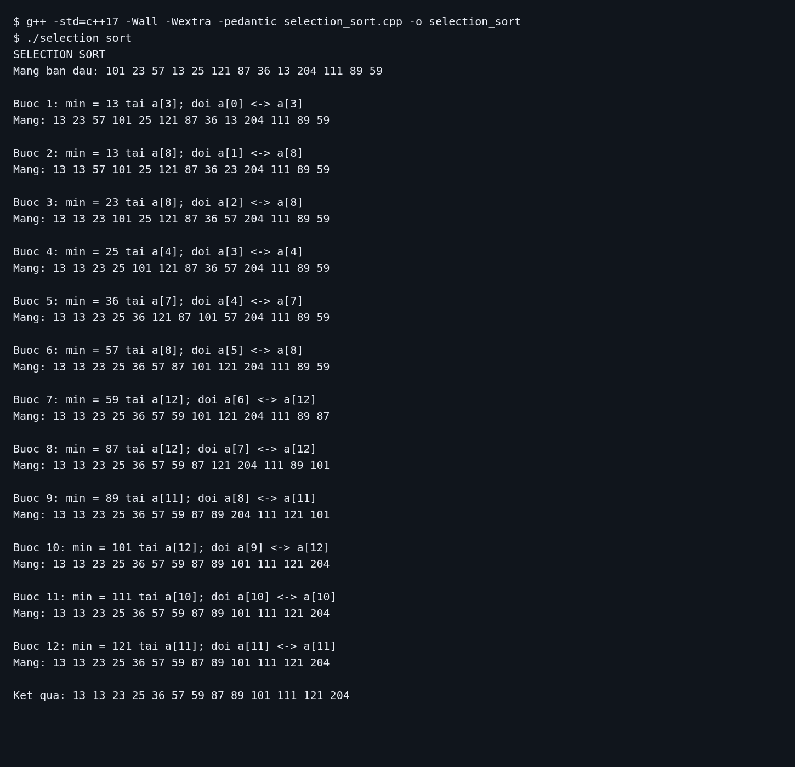
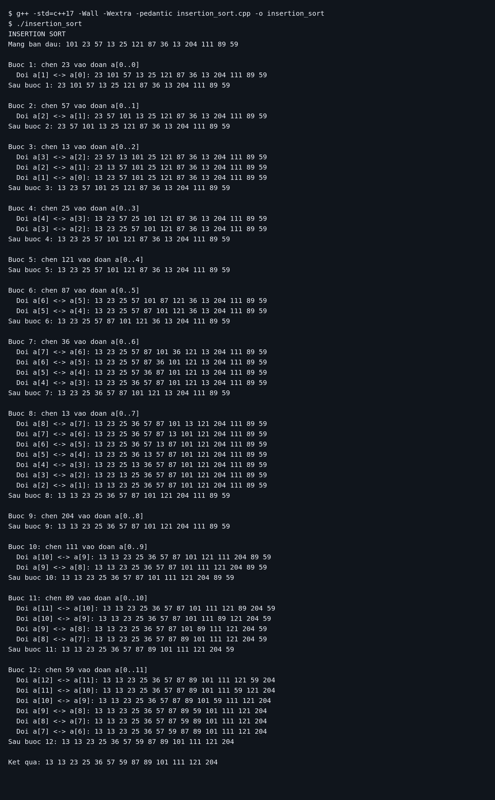

# Tuần 4 — Selection Sort và Insertion Sort

Hai chương trình C++ sắp xếp mảng tăng dần và in từng bước thực hiện.

```cpp
const int n = 13;
int a[n] = {101, 23, 57, 13, 25, 121, 87, 36, 13, 204, 111, 89, 59};
```

Chỉ số mảng bắt đầu từ `0`. Số sau `204` là `111`, theo xác nhận của người dùng.

## Biên dịch và chạy

Mở terminal ở thư mục bài tập. Cần có trình biên dịch `g++`.

```bash
cd "/home/huyle/code c++/Tuan 4"
```

Chạy Selection Sort:

```bash
g++ -std=c++17 -Wall -Wextra -pedantic selection_sort.cpp -o selection_sort
./selection_sort
```

Chạy Insertion Sort:

```bash
g++ -std=c++17 -Wall -Wextra -pedantic insertion_sort.cpp -o insertion_sort
./insertion_sort
```

Mỗi file có một hàm `main()`, nên biên dịch riêng từng file.

## Selection Sort — sắp xếp chọn

Ở mỗi lượt `i`, tìm số nhỏ nhất trong đoạn `a[i..n-1]`, rồi đổi chỗ với `a[i]`. Sau lượt này, đoạn `a[0..i]` đã được sắp xếp và nằm đúng vị trí cuối cùng.

Chương trình in số nhỏ nhất, chỉ số của nó trước khi đổi chỗ và toàn bộ mảng sau mỗi lượt. Nếu `index == i`, phần tử đã đúng vị trí; đổi chỗ với chính nó không làm thay đổi mảng.

- Bước 1: chọn `13` tại `a[3]`, đổi với `101` tại `a[0]`.
- Bước 2: chọn `13` còn lại tại `a[8]`, đổi với `23` tại `a[1]`.
- Tiếp tục đến bước 12; phần tử cuối tự nằm đúng vị trí.

Ảnh dưới chụp bản hiển thị đầu ra terminal từ lần chạy thực, gồm đầy đủ 12 bước. Đầu ra dạng văn bản nằm trong [logs/selection_sort.txt](logs/selection_sort.txt).



## Insertion Sort — sắp xếp chèn

Ở mỗi lượt `i` từ `1`, đoạn `a[0..i-1]` đã tăng dần. Chèn phần tử `a[i]` vào đoạn đó bằng cách đổi chỗ liên tiếp với phần tử bên trái khi nó nhỏ hơn phần tử bên trái. Dừng khi đến đầu mảng hoặc đã đúng thứ tự.

Hàm `Swap(int &a, int &b)` dùng tham chiếu để đổi trực tiếp hai phần tử của mảng.

Chương trình in giá trị cần chèn, toàn bộ mảng sau từng lần đổi chỗ và mảng sau mỗi lượt chèn.

- Bước 1: chèn `23` vào đoạn chứa `101`, được `23 101`.
- Bước 2: chèn `57` vào đoạn `23 101`, được `23 57 101`.
- Bước 3: chèn `13`, đổi chỗ lần lượt với `101`, `57`, `23`, được `13 23 57 101`.
- Nếu không cần đổi chỗ, chương trình vẫn in mảng sau lượt chèn đó.

Ảnh dưới chụp bản hiển thị đầu ra terminal từ lần chạy thực, gồm đầy đủ các lần đổi chỗ và 12 lượt chèn. Đầu ra dạng văn bản nằm trong [logs/insertion_sort.txt](logs/insertion_sort.txt).



## Kết quả của cả hai thuật toán

```text
13 13 23 25 36 57 59 87 89 101 111 121 204
```

Hai file đã được biên dịch với `-std=c++17 -Wall -Wextra -pedantic` và chạy kiểm tra. Cả hai giữ đủ 13 phần tử, bao gồm hai số `13`, và cho cùng kết quả tăng dần.

Với cách cài đặt này, Selection Sort có thời gian `O(n²)`; Insertion Sort có thời gian xấu nhất `O(n²)` và tốt nhất `O(n)` khi mảng đã tăng dần. Cả hai dùng bộ nhớ phụ `O(1)`. Các độ phức tạp này chỉ tính việc sắp xếp, không tính phần in minh họa.
